# terminal-svg-demo

Render an animated terminal session as declarative SVG, for a README or a
documentation page.

The animation uses SMIL: a plain image for every browser, no JavaScript,
no media player, no GIF. Python standard library only.

<div align="center">



</div>

The animation above was generated by the tool describing itself:
`terminal-svg-demo examples/self-demo.json self-demo.svg`.

Another example: the [euromillions](https://github.com/alaunay/euromillions)
README.

## Install

```console
$ pipx install git+https://github.com/alaunay/terminal-svg-demo.git
```

or, from a clone:

```console
$ python3 -m pip install .
```

## Usage

```console
$ terminal-svg-demo SPEC.json OUTPUT.svg
$ terminal-svg-demo SPEC.json          # writes demo.svg here
$ python3 -m terminal_svg_demo SPEC.json OUTPUT.svg
```

The parent directory of the target is created when needed. The output is
deterministic: same spec, same bytes.

Options: `-l, --lang CODE` picks the message language, `-h, --help` shows
the options and the available languages.

For the euromillions repository:

```console
$ terminal-svg-demo euromillions/assets/demo.json euromillions/assets/demo.svg
```

## Spec

A JSON file. Only `sessions` is required; every other key falls back to a
default.

```json
{
  "title": "euromillions",
  "sessions": [
    {
      "command": "./euromillions.sh",
      "outputs": [
        {"label": "Numbers:", "value": "4 8 13 36 46", "color": "#4d6bff"},
        {"label": "Stars:", "value": "3 12", "color": "#eebb05"}
      ]
    }
  ],
  "colors": {
    "prompt": "#39ff14",
    "command": "#e6edf3",
    "label": "#9aa4b2"
  }
}
```

| Key | Default | Meaning |
| --- | --- | --- |
| `title` | `terminal` | text in the window title bar |
| `width` | `720` | viewport width |
| `sessions` | `[]` | commands, in order, each with its `outputs` |
| `colors.background` | `#0d1117` | window background |
| `colors.title_background` | `#161b22` | title bar |
| `colors.title_text` | `#8b949e` | title text |
| `colors.prompt` | `#3fb950` | `$` |
| `colors.command` | `#c9d1d9` | typed command and cursor |
| `colors.label` | `#8b949e` | output label |

Each output needs `label`, `value`, and its own `color`. The layout, the
typing speed, the pauses, and the height follow from the number of
sessions and outputs. A spec that breaks the shape is rejected with a
message naming the field.

More keys, for finer control: `title_bar`, `first_line`, `line_height`,
`left`, `prompt_width`, `value_column`, `font_size`, `char_width`,
`typing`, `start`, `line_pause`, `session_pause`, `hold`.

## Languages

Messages are GNU gettext catalogues: `po/terminal-svg-demo.pot` is the
template, `po/<code>.po` the translator file, English being the msgid
language. French (`fr`) is provided.

```console
$ terminal-svg-demo -l fr examples/self-demo.json self-demo.svg
écrit : self-demo.svg
```

The language comes from `--lang`, then `LANGUAGE`, `LC_ALL`, or `LANG`,
then English. A requested language without a catalogue prints a warning
on stderr and continues in English.

Add a language by copying the template, filling the `msgstr` entries, and
building:

```console
$ cp po/terminal-svg-demo.pot po/de.po
$ $EDITOR po/de.po
$ tools/build-locales.sh
```

`tools/build-locales.sh` runs `msgfmt --check`, which rejects a
translation whose placeholders drift from the source. After changing a
msgid, regenerate the template:

```console
$ xgettext --language=Python --keyword=_ --output=po/terminal-svg-demo.pot \
    src/terminal_svg_demo/*.py
$ msgmerge -U po/fr.po po/terminal-svg-demo.pot
```

## Requirements

- Python 3.10 or later
- no third-party package at runtime
- `gettext` only to build the catalogues
- `bats` and `shellcheck` only for development

## Development

```console
$ python3 -m venv .venv
$ .venv/bin/pip install -e ".[dev]"
$ .venv/bin/ruff check .
$ .venv/bin/ruff format --check .
$ .venv/bin/mypy src/terminal_svg_demo
$ .venv/bin/coverage run -m unittest discover -s tests
$ .venv/bin/coverage report
$ shellcheck tools/build-locales.sh .githooks/commit-msg
$ bats tests/shell
$ tools/build-locales.sh
```

`ruff` 0.17.4, `mypy`, and `coverage` are pinned in the `dev` extra. CI
runs the commands, including shellcheck and the bats suite, plus a check that the committed examples match the
generator, on every push to `master` and on every pull request. The test
matrix covers Python 3.10 to 3.13.

## Contributing

`master` only takes pull requests, and every pull request must:

- be GPG-signed, or GitHub rejects the push;
- carry `Co-authored-by` and `Signed-off-by` trailers, which the `dco`
  check enforces;
- pass `checks`, `tests`, and `dco`.

```console
$ git switch -c my-change
$ ...edit, commit, test...
$ git push -u origin my-change
$ gh pr create --fill
$ gh pr merge --squash --delete-branch
```

## Changelog

See [CHANGELOG.md](CHANGELOG.md).

## License

[GPL-3.0](LICENSE), or <https://www.gnu.org/licenses/gpl-3.0.html>.
